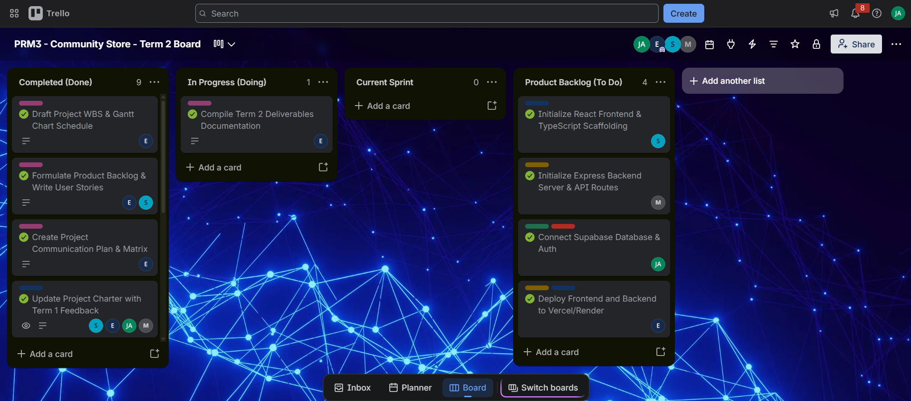

# Hi there, I'm Jayden Avontuur 
I'm a recent **ICT Applications Development** graduate from the Cape Peninsula University of Technology (CPUT). I've built real-world projects that have helped me develop practical skills and a solid understanding of software development.

---

## About Me
- 🎓 Diploma in ICT Applications Development — CPUT (2024–present)
- 📍 Based in Cape Town, South Africa
- 📧 jaydenavontuur19@gmail.com
- 📱 081 377 0794
- 🌱 Currently exploring IoT, Project Management, Domain-Driven Design in Java and Information Systems

---

## Skills

| Category | Technologies |
| --- | --- |
| **Languages** | Java, Python, HTML, CSS, JavaScript |
| **Database** | MySQL, Apache Derby |
| **Design** | UI/UX Design |
| **Concepts** | Data Structures & Algorithms, Client-Server Architecture |

---

## Projects

### Student Enrolment System
> *September 2025 – October 2025*

A **Java** client-server application that allows students to enrol in courses. Enrolment data is stored in a **Derby database**, and the system includes user authentication with separate **admin** and **student** roles.

**Key features:**
- Single client/server architecture
- Role-based access control (admin vs. student)
- Course enrolment and data persistence

---

### ResFinder — Student Accommodation Finder App
> *March 2025 – October 2025*

A desktop application built with **Java Swing**, developed as part of the PRT262S Project 2 (Application Development) subject at CPUT. The app helps students find suitable accommodation near campus.

**Key features:**
- Java Swing desktop UI
- Developed as part of an academic project at CPUT

---

## Education

### Diploma in ICT Applications Development
**Cape Peninsula University of Technology** | *February 2024 – Present*
> Applications Development Practice 3, Applications Development Theory 3, ICT Electives 3: Internet of Things, Information Systems 3, Professional Practice 3, Project 3, Project Management 3, Project Presentation 3

---

### Higher Certificate: Information Technology Service Management
**Cape Peninsula University of Technology** | *February 2022 – November 2023*
> Business Practice, ICT Fundamentals, Information Technology Service Practice, ITSM, Professional Communications, Programming 1, Quantitative Techniques

---

### National Senior Certificate
*January 2017 – December 2021*
> English Home Language, Afrikaans, Mathematical Literacy, History, Geography, Computer Applications Technology

---

## Mock Interview

<video width="700" controls>
  <source src="Mock Interview For Prp.mp4" type="video/mp4">
</video>

## Mock Interview Reflection (STAR Method)

**Situation:** I participated in a mock interview as part of my work readiness training for PRP370S.

**Task:** Answer interview questions confidently and professionally to demonstrate my readiness for the workplace.

**Action:** I answered questions about my passion for technology, how I manage stress through exercise and hobbies, and how I prioritized tasks during a busy exam period while also handling an unreliable group project.

**Result:** The experience built my confidence and gave me a realistic preview of job interviews, highlighting areas I do well and areas I can still improve.

---

## Markdown Reflection (STAR Method)

**Situation:** I had to build a digital portfolio using GitHub for my PRP370S assessment.

**Task:** Code my entire portfolio using GitHub Flavoured Markdown (GFM).

**Action:** I researched Markdown syntax and applied features like headers, tables, bullet lists, and links throughout my `README.md` file.

**Result:** My portfolio rendered cleanly and professionally on GitHub Pages, and I now feel confident using Markdown in future projects.

---

## GitHub Pages Reflection (STAR Method)

**Situation:** I needed to deploy my portfolio publicly for my PRP370S submission.

**Task:** Configure and publish my GitHub repository using GitHub Pages.

**Action:** I enabled GitHub Pages in my repository settings, selected the correct branch, and verified everything rendered correctly on the live URL.

**Result:** My portfolio is live at [https://jaydenchoppa.github.io/](https://jaydenchoppa.github.io/). I gained practical experience with deployment that will be valuable in my career.

---

# Agile Project Management Portfolio
 
This section collects the Agile artefacts from my **CampusMarket** project. Each artefact has its **evidence** (what the team produced and what I contributed) followed by a **reflection** (what it taught me).
 
---
 
## 1. Agile Team Charter
 
An Agile team charter is a living social contract that defines the team's shared purpose, values, working agreements and boundaries.
 
### Evidence
 
**Project:** CampusMarket, a mobile-first marketplace where CPUT students and staff buy and sell items and post campus notices.
**Charter document:** [View the Agile Team Charter](./docs/agile-team-charter.pdf)
 
**Team members**
 
| Team member | Role | Main responsibilities |
| --- | --- | --- |
| Ebenezer | Project Lead | Project schedule (WBS and Gantt chart), communication plan, deployment, compiling the deliverables documentation |
| **Jayden Avontuur** | **Database, Authentication and Security Developer** | **Connecting the Supabase database, the authentication middleware that protects the API routes, and payment security** |
| Matthew | Backend Developer | Express backend server and API routes |
| Siphesihle | Frontend Developer | React and TypeScript frontend scaffolding, user stories and backlog |
 
**Charter highlights**
- **Purpose:** Build a safe, trusted marketplace for the CPUT community where trading is tied to authenticated users.
- **Values:** Open communication, accountability for our own tasks, and respect for each other's ideas.
- **Working agreements:** Work is tracked on the shared Trello board, every member updates their own cards, blockers are raised with the team straight away, and the charter is updated whenever feedback changes how we work.
- **Boundaries:** Scope stays within the core marketplace features (authentication, products, bulletin posts and transactions), and decisions that affect everyone are made together.
### Reflection — Agile Team Charter (STAR Method)
 
**Situation:** Our team of four was starting a project where everyone had a different role and different habits, so we needed shared agreements before writing any code.
 
**Task:** I had to understand the charter, contribute to it, and agree to the working practices it set out for how we would communicate and hold each other accountable.
 
**Action:** I took part in revising the charter after we received feedback, and I made sure my role in the database and authentication work was clearly stated so the team knew who to ask about data and login questions.
 
**Result:** The charter gave us one reference point when we were unsure who owned a task or how to raise a problem. I learned that a charter is only useful if the team keeps updating it, and I would revisit it more often as the project changes.
 
---
 
## 2. User Stories and Tasks
 
A user story is a short description of a feature from the end-user's perspective. Each story is then broken down into tasks.
 
### Evidence
 
**Document:** [View the User Stories](./docs/user-stories.pdf)
 
| ID | User story | Tasks |
| --- | --- | --- |
| US-01 | As a **student**, I want to **sign up and log in**, so that **my listings and purchases are tied to me**. | Connect Supabase database and auth · Build login/register screens · Add protected routes |
| US-02 | As a **seller**, I want to **list an item with a photo and price**, so that **other students can find it**. | Build listing form · `POST /api/products` (auth required) · Image upload and fallback placeholder |
| US-03 | As a **buyer**, I want to **browse products**, so that **I can find what I need**. | `GET /api/products` · Product grid UI · Mobile-first layout |
| US-04 | As a **student or staff member**, I want to **post a campus notice that expires**, so that **the board stays current**. | `POST /api/bulletin_posts` · Expiry logic · Active-posts filter |
| US-05 | As a **buyer**, I want to **pay through an escrow-style flow**, so that **I trust the trade**. | `POST /api/transactions` · Status flow design · Transaction UI |
 
### Reflection — User Stories and Tasks (STAR Method)
 
**Situation:** The team had a broad idea of a campus marketplace, but it was too large to build without breaking it into pieces that each person could own.
 
**Task:** I needed to understand each story well enough to turn the ones involving data and login into concrete database and authentication tasks.
 
**Action:** I used the user stories to work out what data the system needed to store and who could access it, and I linked my Supabase and authentication task to the sign-up and login story.
 
**Result:** Writing stories from the user's point of view stopped us from building features nobody asked for, and splitting them into tasks made it clear who was doing what. I learned that a good story explains the reason for a feature, not just the feature.
 
---
 
## 3. Product Backlog
 
A product backlog is a prioritised list of all the work, features, bug fixes and improvements the product needs.
 
### Evidence
 
Our Trello board is private, so the board is shown as a screenshot below.
 

 
| Backlog item | Owner | Board list |
| --- | --- | --- |
| Initialize React Frontend & TypeScript Scaffolding | Siphesihle | Product Backlog (To Do) |
| Initialize Express Backend Server & API Routes | Matthew | Product Backlog (To Do) |
| Connect Supabase Database & Auth | Jayden | Product Backlog (To Do) |
| Deploy Frontend and Backend to Vercel/Render | Ebenezer | Product Backlog (To Do) |
| Formulate Product Backlog & Write User Stories | Ebenezer, Siphesihle | Completed (Done) |
| Draft Project WBS & Gantt Chart Schedule | Ebenezer | Completed (Done) |
| Create Project Communication Plan & Matrix | Ebenezer | Completed (Done) |
| Update Project Charter with Feedback | Siphesihle, Ebenezer, Jayden, Matthew | Completed (Done) |
| Compile Deliverables Documentation | Ebenezer | In Progress (Doing) |
 
### Reflection — Product Backlog (STAR Method)
 
**Situation:** After the planning documents were done, the team had to decide which technical work to tackle and in what order.
 
**Task:** My responsibility was the Supabase database and authentication item, so I had to understand where it sat in the order of work.
 
**Action:** I looked at how the backlog items depended on each other and saw that the frontend, the backend and the deployment all rely on the database and login working. I used that to argue that my item should be prepared early.
 
**Result:** Having one ordered list on the board meant the whole team could see what came next and why. I learned that prioritising by dependency, not just by what feels most exciting, keeps the team from getting blocked.
 
---
 
## 4. Sprint Backlog
 
A sprint backlog is the actionable plan created by the developers for the specific work needed to reach the sprint goal.
 
### Evidence
 
**Sprint goal:** Deliver the technical foundation of CampusMarket: the frontend and backend projects set up, the database and authentication connected, and the application ready to deploy.
 

 
| Task | Linked story | Owner | Status |
| --- | --- | --- | --- |
| Initialize React Frontend & TypeScript Scaffolding | US-03 | Siphesihle | To Do |
| Initialize Express Backend Server & API Routes | US-02, US-03 | Matthew | To Do |
| Connect Supabase Database & Auth | US-01 | Jayden | To Do |
| Deploy Frontend and Backend to Vercel/Render | All stories | Ebenezer | To Do |
 
### Reflection — Sprint Backlog (STAR Method)
 
**Situation:** The product backlog was too big to tackle at once, so the team needed a smaller set of work with a clear goal.
 
**Task:** I had to commit to the part of the sprint that was mine: connecting Supabase and getting authentication working.
 
**Action:** I treated my card as the foundation for the others, keeping it small and well defined so the frontend and backend developers could build on it without waiting. I built the authentication middleware that checks a user's token before the product, bulletin board and transaction routes will run.
 
**Result:** Pulling a focused set of tasks from the backlog showed me the difference between everything we want to build and what we can realistically finish. Next time I would move cards into the Current Sprint list as soon as the team commits, so the board always matches the plan.
 
---
 
## 5. Agile Logbook
 
An agile logbook records daily stand-ups, sprint plans and retrospective notes.
 
### Evidence
 
**Full logbook:** [View the Agile Logbook](./docs/agile-logbook.pdf)
 
| Entry | Type | What happened |
| --- | --- | --- |
| 1 | Sprint planning | Agreed the sprint goal and chose the frontend setup, backend setup, Supabase and auth, and deployment tasks, each with an owner. |
| 2 | Stand-up | Done: charter updated with feedback, user stories written. Doing: compiling the deliverables documentation. Blockers: none. |
| 3 | Stand-up | Done: planning documents complete. Doing: preparing the technical setup tasks. Blockers: the database and auth must be ready before the other tasks can build on it. |
| 4 | Retrospective | Went well: clear ownership of cards and good communication. To improve: keep the Current Sprint list up to date and break large cards into smaller tasks. |
 
### Reflection — Agile Logbook (STAR Method)
 
**Situation:** With four people working on connected parts of one system, it was easy to lose track of decisions and problems.
 
**Task:** I had to record my own progress and blockers honestly and take part in the stand-ups and the retrospective.
 
**Action:** I wrote down what I had finished, what I was working on and what was blocking me, and I used the retrospective notes to pick one thing to do differently.
 
**Result:** The logbook made problems visible early and gave the team a record to learn from. I learned that a short, honest log is more useful than a long one written after the fact.
 
---
 
*Thanks for visiting my profile! Feel free to check out my repositories.*
